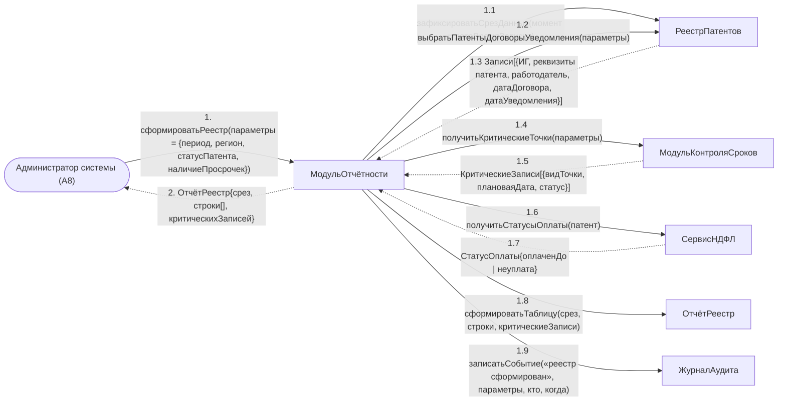

# Операция `сформироватьРеестр`

**Дисциплина:** Функциональное моделирование систем · **ТюмГУ**, 5 семестр · **Преподаватель:** Ткаченко И. Н.  
**Тема (раздел дорожной карты):** Тема 7. Действия после получения патента · **Команда:** Малышева Елена, Макеев Глеб, Мальгин Олег · **Автор работы:** Макеев Глеб Борисович  
**Дата:** 18.10.2026 · **Репозиторий:** <https://github.com/mflkee/fms-course>

> **Лабораторная 4, диаграмма коммуникаций** (взаимодействие объектов). Одна диаграмма — на одну системную операцию из лаб. 3. Объекты — экземпляры классов модели предметной области (лаб. 2) и концептуальные компоненты подсистемы; привязки к языку и фреймворку нет.

| | |
|---|---|
| **Системная операция** | `сформироватьРеестр(параметры: ПараметрыОтчёта) : РеестрПатентов` |
| **Прецедент** | П07 — [П07. Формирование реестра и отчёта по патентам и договорам](../../lab1-usecases/usecases/07-reestr-i-otchety.md) |
| **Диаграмма последовательностей (лаб. 3)** | [18-p07-osnovnoy](../../lab3-sequence-diagrams/diagrams/18-p07-osnovnoy.md) |
| **Инварианты лаб. 2** | **ИНВ-2**, **ИНВ-3** |
| **Файлы** | [`15-sformirovat-reestr.puml`](15-sformirovat-reestr.puml) · [`15-sformirovat-reestr.png`](15-sformirovat-reestr.png) |

**Назначение операции:** построить сводный реестр патентов, договоров, уведомлений и платежей по заданным параметрам, выделив критические записи и зафиксировав срез данных.

## 1. Объекты

| Объект | Тип | Соответствие модели лаб. 2 |
|---|---|---|
| `Администратор системы (A8)` | актор | актор A8 — основной исполнитель П07 |
| `МодульОтчётности` | компонент | концептуальный компонент построения отчётов; единственный компонент, работающий только на чтение |
| `РеестрПатентов` | хранилище | хранилище учётных сущностей — источник строк реестра |
| `МодульКонтроляСроков` | компонент | компонент, выдающий критические (просроченные) контрольные точки |
| `СервисНДФЛ` | компонент | компонент учёта платежей — источник колонки «статус оплаты» |
| `ОтчётРеестр` | сущность | проекция данных реестра (результат отчёта). Отдельным классом предметной области не является: в лаб. 2 сущности «Отчёт» нет |
| `ЖурналАудита` | компонент | журнал аудита — фиксирует факт формирования отчёта |

## 2. Диаграмма коммуникаций

PlantUML-исходник (диаграмма объектов с нумерованными стрелками): [`15-sformirovat-reestr.puml`](15-sformirovat-reestr.puml); растровый рендер: [`15-sformirovat-reestr.png`](15-sformirovat-reestr.png).

## 3. Сообщения

| № | Сообщение | Отправитель | Получатель | Назначение |
|---|---|---|---|---|
| **1** | `сформироватьРеестр(параметры = {период, регион, статусПатента, наличиеПросрочек})` | Администратор системы (A8) | МодульОтчётности | Точка входа: администратор задаёт параметры отчёта. |
| **1.1** | `зафиксироватьСрезДанных(момент = датаВремяЗапуска)` | МодульОтчётности | РеестрПатентов | Срез данных фиксируется на момент запуска, чтобы отчёт не «плавал» во время построения. |
| **1.2** | `выбратьПатентыДоговорыУведомления(параметры)` | МодульОтчётности | РеестрПатентов | Основная выборка. |
| **1.3** *(возврат)* | `Записи[{ИГ, реквизиты патента, работодатель, датаДоговора, датаУведомления}]` | РеестрПатентов | МодульОтчётности | Строки реестра по отобранным патентам. |
| **1.4** | `получитьКритическиеТочки(параметры)` | МодульОтчётности | МодульКонтроляСроков | Критические записи (просрочки) должны быть видны сразу, без дополнительной фильтрации. |
| **1.5** *(возврат)* | `КритическиеЗаписи[{видТочки, плановаяДата, статус}]` | МодульКонтроляСроков | МодульОтчётности | Перечень просроченных и критических точек. |
| **1.6** | `получитьСтатусыОплаты(патент)` | МодульОтчётности | СервисНДФЛ | Колонка «статус оплаты». |
| **1.7** *(возврат)* | `СтатусОплаты{оплаченДо | неуплата}` | СервисНДФЛ | МодульОтчётности | Ответ сервиса НДФЛ. |
| **1.8** | `сформироватьТаблицу(срез, строки, критическиеЗаписи)` | МодульОтчётности | ОтчётРеестр | Создание проекции отчёта; критические записи подсвечиваются. |
| **1.9** | `записатьСобытие(«реестр сформирован», параметры, кто, когда)` | МодульОтчётности | ЖурналАудита | Фиксация факта формирования отчёта — требование П07. |
| **2** *(возврат)* | `ОтчётРеестр{срез, строки[], критическихЗаписей}` | МодульОтчётности | Администратор системы (A8) | Возврат реестра администратору. |

## 4. Решения и примечания

- Отчёт — проекция: единственные изменения в системе от этой операции — запись в журнале аудита. Поэтому в диаграмме нет изменения состояний учётных сущностей.
- Три источника данных (хранилище, модуль сроков, сервис НДФЛ) соответствуют трём группам колонок реестра: договоры и уведомления, сроки, оплата.
- Срез данных (1.1) — прямое следствие специального требования П07: «изменения после среза отражаются только в следующем отчёте».

Назад: [README лаб. 4](../README.md) · [спецификация операций лаб. 3](../../lab3-sequence-diagrams/operations.md) · [прецедент](../../lab1-usecases/usecases/07-reestr-i-otchety.md)
