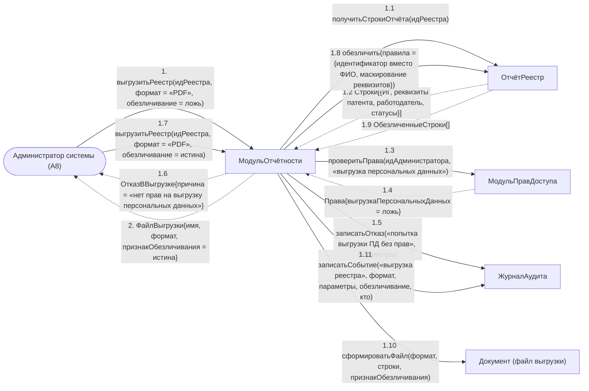

# Операция `выгрузитьРеестр`

**Дисциплина:** Функциональное моделирование систем · **ТюмГУ**, 5 семестр · **Преподаватель:** Ткаченко И. Н.  
**Тема (раздел дорожной карты):** Тема 7. Действия после получения патента · **Команда:** Малышева Елена, Макеев Глеб, Мальгин Олег · **Автор работы:** Макеев Глеб Борисович  
**Дата:** 18.10.2026 · **Репозиторий:** <https://github.com/mflkee/fms-course>

> **Лабораторная 4, диаграмма коммуникаций** (взаимодействие объектов). Одна диаграмма — на одну системную операцию из лаб. 3. Объекты — экземпляры классов модели предметной области (лаб. 2) и концептуальные компоненты подсистемы; привязки к языку и фреймворку нет.

| | |
|---|---|
| **Системная операция** | `выгрузитьРеестр(идРеестра: UUID, формат: ФорматВыгрузки, обезличивание: Boolean) : ФайлВыгрузки` |
| **Прецедент** | П07 — [П07. Формирование реестра и отчёта по патентам и договорам](../../lab1-usecases/usecases/07-reestr-i-otchety.md) |
| **Диаграмма последовательностей (лаб. 3)** | [19-p07-alternativa-vygruzka-za-period](../../lab3-sequence-diagrams/diagrams/19-p07-alternativa-vygruzka-za-period.md) |
| **Инварианты лаб. 2** | **ИНВ-8** |
| **Файлы** | [`16-vygruzit-reestr.puml`](16-vygruzit-reestr.puml) · [`16-vygruzit-reestr.png`](16-vygruzit-reestr.png) |

**Назначение операции:** выгрузить сформированный реестр в файл, выдав персональные данные только в объёме прав администратора и зафиксировав факт выгрузки в журнале аудита.

## 1. Объекты

| Объект | Тип | Соответствие модели лаб. 2 |
|---|---|---|
| `Администратор системы (A8)` | актор | актор A8 — инициатор выгрузки |
| `МодульОтчётности` | компонент | компонент построения отчётов и выгрузки |
| `МодульПравДоступа` | компонент | концептуальный компонент проверки прав доступа (вне предметной области лаб. 2) |
| `ОтчётРеестр` | сущность | проекция данных реестра — источник строк файла |
| `Документ (файл выгрузки)` | сущность | файл выгрузки (результат операции) |
| `ЖурналАудита` | компонент | журнал аудита — фиксирует и успешную выгрузку, и отказ |

## 2. Диаграмма коммуникаций

PlantUML-исходник (диаграмма объектов с нумерованными стрелками): [`16-vygruzit-reestr.puml`](16-vygruzit-reestr.puml); растровый рендер: [`16-vygruzit-reestr.png`](16-vygruzit-reestr.png).

## 3. Сообщения

| № | Сообщение | Отправитель | Получатель | Назначение |
|---|---|---|---|---|
| **1** | `выгрузитьРеестр(идРеестра, формат = «PDF», обезличивание = ложь)` | Администратор системы (A8) | МодульОтчётности | Точка входа: администратор запрашивает выгрузку. Начинается с попытки получить полные данные (альтернатива 6а П07). |
| **1.1** | `получитьСтрокиОтчёта(идРеестра)` | МодульОтчётности | ОтчётРеестр | Получение строк сформированного реестра. |
| **1.2** *(возврат)* | `Строки[{ИГ, реквизиты патента, работодатель, статусы}]` | ОтчётРеестр | МодульОтчётности | Строки содержат персональные данные ИГ. |
| **1.3** | `проверитьПрава(идАдминистратора, «выгрузка персональных данных»)` | МодульОтчётности | МодульПравДоступа | Проверка прав перед выдачей файла. |
| **1.4** *(возврат)* | `Права{выгрузкаПерсональныхДанных = ложь}` | МодульПравДоступа | МодульОтчётности | Права на выгрузку персональных данных нет — выгрузка в полном виде невозможна. |
| **1.5** | `записатьОтказ(«попытка выгрузки ПД без прав», параметры)` | МодульОтчётности | ЖурналАудита | Отказ фиксируется в журнале аудита — требование специальных условий П07. |
| **1.6** *(возврат)* | `ОтказВВыгрузке{причина = «нет прав на выгрузку персональных данных»}` | МодульОтчётности | Администратор системы (A8) | Администратор получает отказ с объяснением причины. |
| **1.7** | `выгрузитьРеестр(идРеестра, формат = «PDF», обезличивание = истина)` | Администратор системы (A8) | МодульОтчётности | Повторный вызов операции в допустимом режиме. |
| **1.8** | `обезличить(правила = {идентификатор вместо ФИО, маскирование реквизитов})` | МодульОтчётности | ОтчётРеестр | Обезличивание: идентификатор вместо ФИО, маскированные реквизиты документов. |
| **1.9** *(возврат)* | `ОбезличенныеСтроки[]` | ОтчётРеестр | МодульОтчётности | Строки, пригодные к выгрузке. |
| **1.10** | `сформироватьФайл(формат, строки, признакОбезличивания)` | МодульОтчётности | Документ (файл выгрузки) | Создание файла выгрузки в выбранном формате (CSV или PDF). |
| **1.11** | `записатьСобытие(«выгрузка реестра», формат, параметры, обезличивание, кто)` | МодульОтчётности | ЖурналАудита | Аудит выгрузки: кто, когда, с какими параметрами и в каком виде получил данные. |
| **2** *(возврат)* | `ФайлВыгрузки{имя, формат, признакОбезличивания = истина}` | МодульОтчётности | Администратор системы (A8) | Возврат файла администратору. |

## 4. Решения и примечания

- Обе попытки выгрузки (отказ в 1.4–1.6 и успешная в 1.7–1.11) показаны на одной диаграмме: это одна системная операция, две ветви которой различаются только правами доступа.
- Компонент `MP` (МодульПравДоступа) введён как концептуальный: права администратора — требование П07, но в модели предметной области лаб. 2 сущность «право доступа» не выделялась (есть только атрибут `АдминистраторСистемы.правоВыгрузки`).
- Выгрузка во внешние системы (МВД, ФНС) в модели отсутствует — отчёт служебный, внутренний; это зафиксировано как открытый вопрос П07 в лаб. 1.

Назад: [README лаб. 4](../README.md) · [спецификация операций лаб. 3](../../lab3-sequence-diagrams/operations.md) · [прецедент](../../lab1-usecases/usecases/07-reestr-i-otchety.md)
