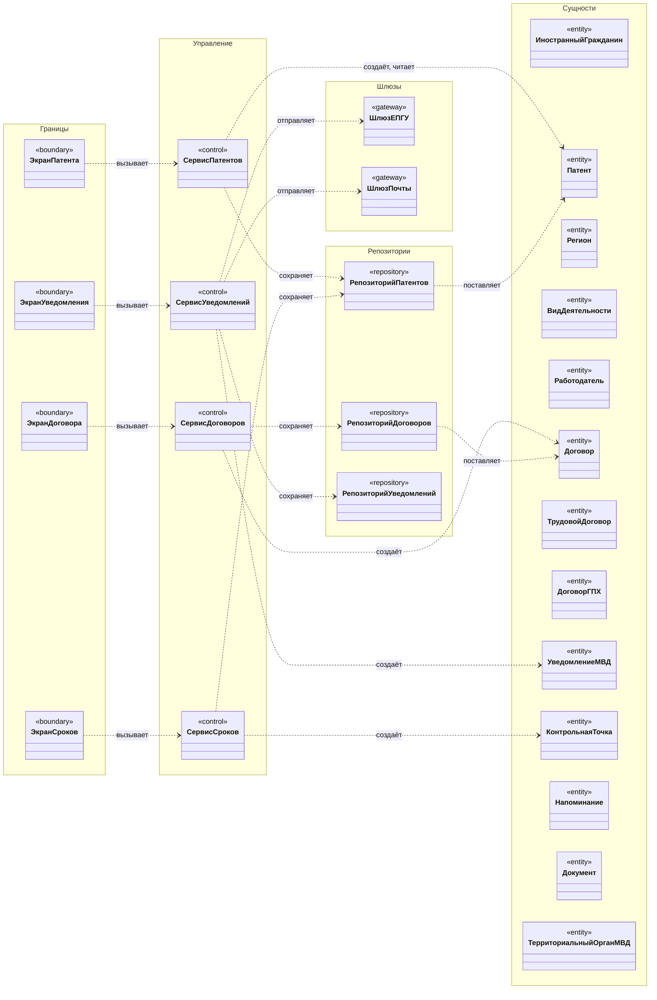

# Диаграмма 01. Слои модели проектирования

**Дисциплина:** Функциональное моделирование систем · **ТюмГУ**, 5 семестр · **Преподаватель:** Ткаченко И. Н.
**Тема (раздел дорожной карты):** Тема 7. Действия после получения патента · **Команда:** Малышева Елена, Макеев Глеб, Мальгин Олег
**Автор работы:** Макеев Глеб, Мальгин Олег Борисович · **Дата:** 20.11.2026 · **Репозиторий:** <https://github.com/mflkee/fms-course>

> **Лабораторная 5, обзорная диаграмма.** Показывает все **26 классов** модели проектирования и
> направление зависимостей: границы → управление → сущности, репозитории, шлюзы. Состав и сигнатуры
> методов раскрыты на диаграммах [02](02-patent-dogovor.md) и [03](03-uvedomleniya-sroki.md).

## 1. Что показывает диаграмма

- **Пять слоёв, 26 классов.** Границы (4) вызывают управление (4); управление создаёт и читает
  сущности (13), сохраняет их через репозитории (3) и отправляет документы через шлюзы (2).
  Обратных зависимостей нет: сущность не знает, кто её хранит; экран не знает, где лежат данные.
- **Ровно 10 операций.** Каждый метод управления назван так же, как системная операция
  [DESIGN.md §3](../../DESIGN.md); у каждого экрана методов столько же, сколько операций его прецедента.
- **У сущностей только атрибуты.** Поведение (проверки инвариантов, расчёт сроков, смена статусов) —
  в управляющем слое; у 13 сущностей нет ни одного метода.
- **Репозиторий на агрегат.** Три хранилища: патенты (вместе с контрольными точками и напоминаниями),
  договоры, уведомления. Отдельных хранилищ документов и справочников нет: `Документ` входит в
  агрегаты, а справочные `Регион` и `ВидДеятельности` читаются вместе с патентом.

## 2. Состав по слоям

| Слой | Стереотип | Классы | Сколько |
|---|---|---|---|
| Границы | `<<boundary>>` | `ЭкранПатента`, `ЭкранДоговора`, `ЭкранУведомления`, `ЭкранСроков` | 4 |
| Управление | `<<control>>` | `СервисПатентов`, `СервисДоговоров`, `СервисУведомлений`, `СервисСроков` | 4 |
| Сущности | `<<entity>>` | 13 классов [DESIGN.md §5](../../DESIGN.md) | 13 |
| Репозитории | `<<repository>>` | `РепозиторийПатентов`, `РепозиторийДоговоров`, `РепозиторийУведомлений` | 3 |
| Шлюзы | `<<gateway>>` | `ШлюзЕПГУ`, `ШлюзПочты` | 2 |
| **Итого** | | | **26** |

Точная сумма по составу [DESIGN.md §6](../../DESIGN.md): 4 + 4 + 13 + 3 + 2 = 26 («~23» там — оценка).

| Экран | Прецедент | Операции (методы) |
|---|---|---|
| `ЭкранПатента` | П01 | `зарегистрироватьПатент`, `пометитьПатентАрхивным`, `получитьСведенияОпатенте` |
| `ЭкранДоговора` | П02 | `заключитьДоговор`, `отменитьДоговор` |
| `ЭкранУведомления` | П03 | `направитьУведомлениеМВД`, `зафиксироватьВозвратУведомления` |
| `ЭкранСроков` | П04 | `пересчитатьСрокиПатента`, `настроитьНапоминания`, `зафиксироватьНарушениеСрока` |

## 3. Диаграмма

PlantUML-исходник: [`01-layers.puml`](01-layers.puml) · рендер: [`01-layers.png`](01-layers.png).

## 4. Комментарии к решениям

| Решение | Почему так |
|---|---|
| Границы не связаны с сущностями напрямую | Экран передаёт данные в сервис и получает результат: иначе проверки инвариантов (ИНВ-1, ИНВ-3, ИНВ-4) можно обойти, минуя сервис |
| Одна граница на прецедент | Экран — это то, что видит актор. Четыре прецедента → четыре экрана; методы экрана совпадают с операциями один к одному |
| Экраны не имеют атрибутов | Состояние формы — деталь реализации; в модели важно только то, что экран принимает данные операции и показывает результат |
| Управление — один класс на группу операций | `СервисСроков` держит единственное правило «2 месяца с даты выдачи»; `СервисУведомлений` — единственное место формирования уведомления |
| Три репозитория, а не «хранилище на всё» | Репозиторий обслуживает один агрегат; иначе в лаб. 6 получился бы класс-«бог-объект» |
| Два шлюза | Внешних каналов ровно два — ЕПГУ и Почта России. У шлюза один метод — `отправить`; квитанция и трек-номер возвращаются как результат, статус доставки система не отслеживает |

## 5. Что не показано на этой диаграмме

- Атрибуты и сигнатуры методов — на диаграммах [02](02-patent-dogovor.md) и [03](03-uvedomleniya-sroki.md).
- Ассоциации и кратности между сущностями — там же (это модель предметной области, лаб. 2).
- Перечисления (`СтатусПатента`, `КаналУведомления`, …) — предметные типы, а не классы.
- Проекции результата (`СведенияОпатенте`, `СводкаСроков`) — типы возврата методов, не классы.

Назад: [README лаб. 5](../README.md) · [диаграмма 02](02-patent-dogovor.md)
