# Диаграмма 01. Слои модели проектирования

**Дисциплина:** Функциональное моделирование систем · **ТюмГУ**, 5 семестр · **Преподаватель:** Ткаченко И. Н.
**Тема (раздел дорожной карты):** Тема 7. Действия после получения патента · **Команда:** Малышева Елена, Макеев Глеб
**Автор работы:** Макеев Глеб Борисович · **Дата:** 25.10.2026 · **Репозиторий:** <https://github.com/mflkee/fms-course>

> **Лабораторная 5, обзорная диаграмма классов проектирования.** Показывает схему BCE + слои:
> границы → управление → сущности, хранилища и шлюзы. Классы — без привязки к языку реализации:
> типы атрибутов и параметров предметные (`Дата`, `Сумма`, `Идентификатор`, `ДанныеПатента`).

## 1. Что показывает диаграмма

- **Пять слоёв и направление зависимостей:** граничный → управляющий → сущности; управляющий →
  хранилища и шлюзы. Обратных зависимостей нет: сущность не знает, кто её сохраняет, экран не знает,
  где лежат данные.
- **Типовой срез модели** на примере двух операций: `зарегистрироватьПатент` (экран патента →
  `СервисПатентов` → `Патент` и `РеестрПатентов`) и учёт платежа НДФЛ (экран платежа →
  `СервисНДФЛ` → `ПлатёжНДФЛ`, сверка через `ШлюзФНС`).
- **Правило слоя шлюзов:** внешняя система (ФНС) представлена одним классом-шлюзом; протокол обмена
  (СМЭВ, ГИС ГМП, REST) в модели отсутствует — это уровень реализации.

## 2. Диаграмма

```mermaid
classDiagram
    direction TB

    namespace Граничный {
        class ЭкранПатента {
            <<boundary>>
            -вводимыеДанные : ДанныеПатента
            +ввестиДанные(данные : ДанныеПатента) void
            +приложитьСкан(скан : Документ) void
            +показатьРезультат(результат : РезультатРегистрацииПатента) void
        }
        class ЭкранПлатежаНДФЛ {
            <<boundary>>
            -вводимыйПлатёж : ДанныеПлатежа
            +ввестиПлатёж(данные : ДанныеПлатежа) void
            +приложитьДокумент(документ : Документ) void
            +показатьСтатусОплаты(патент : Патент) void
        }
    }

    namespace Управляющий {
        class СервисПатентов {
            <<control>>
            -правилаПроверки : ПравилаПатента
            +зарегистрировать(данныеПатента : ДанныеПатента, скан : Документ) Патент
            +пометитьАрхивным(идПатента : Идентификатор, причина : Основание) void
            +выдатьСведения(идПатента : Идентификатор, запрашивающий : Пользователь) СведенияОпатенте
        }
        class СервисНДФЛ {
            <<control>>
            -правилоПериодичности : ПравилоОплаты
            +зарегистрироватьПлатёж(идПатента : Идентификатор, данныеПлатежа : ДанныеПлатежа) ПлатёжНДФЛ
            +подтвердить(идПлатежа : Идентификатор, документ : Документ) void
            +прекратитьИзЗаНеуплаты(идПатента : Идентификатор, датаПрекращения : Дата) void
        }
        class МодульКонтроляСроков {
            <<control>>
            -срокТрудоустройства : СрокПравило
            +пересчитать(идПатента : Идентификатор, основание : Основание) СводкаСроков
            +зафиксироватьНарушение(идТочки : Идентификатор, датаОбнаружения : Дата) void
        }
    }

    namespace Сущности {
        class Патент {
            <<entity>>
            -ид : Идентификатор
            -датаВыдачи : Дата
            -датаТрудоустройстваНеПозднее : Дата
            -оплаченДо : Дата
            -статус : СтатусПатента
            +действует(наДату : Дата) Признак
            +рассчитатьСроки() СрокиПатента
            +отметитьОплату(до : Дата) void
        }
        class ПлатёжНДФЛ {
            <<entity>>
            -ид : Идентификатор
            -период : Период
            -сумма : Сумма
            -статус : СтатусПлатежа
            +соответствуетСумме(стоимость : Сумма) Признак
            +подтвердить(документ : Документ, источник : ИсточникПодтверждения) void
        }
        class Регион {
            <<entity>>
            -код : КодРегиона
            -наименование : Наименование
            -стоимостьПатента : Сумма
            +стоимостьНаДату(дата : Дата) Сумма
        }
    }

    namespace Хранилища {
        class РеестрПатентов {
            <<repository>>
            +сохранить(патент : Патент) Патент
            +найти(ид : Идентификатор) Патент
            +найтиДействующий(идИГ : Идентификатор) Патент
        }
        class СправочникРегионов {
            <<repository>>
            +найти(код : КодРегиона) Регион
            +актуальныеНа(дата : Дата) Регион
        }
    }

    namespace Шлюзы {
        class ШлюзФНС {
            <<gateway>>
            +запроситьСостояниеРасчётов(инн : ИНН, период : Период) СостояниеРасчётов
            +передатьСведения(платёж : ПлатёжНДФЛ) void
        }
    }

    ЭкранПатента ..> СервисПатентов : 1 зарегистрироватьПатент
    ЭкранПлатежаНДФЛ ..> СервисНДФЛ : 11, 12 платёж
    СервисПатентов ..> МодульКонтроляСроков : рассчитывает сроки
    СервисНДФЛ ..> МодульКонтроляСроков : пересчитывает сроки
    СервисПатентов ..> РеестрПатентов : запись и чтение
    СервисНДФЛ ..> ПлатёжНДФЛ : создаёт
    СервисПатентов ..> Патент : создаёт
    СервисНДФЛ ..> ШлюзФНС : сверка расчётов
    СправочникРегионов ..> Регион : поставляет
    Патент "1" -- "1" Регион : регион выдачи
```

PlantUML-исходник: [`01-layers.puml`](01-layers.puml) · рендер: [`01-layers.png`](01-layers.png).

## 3. Комментарии к решениям

| Решение | Почему так |
|---|---|
| Границы не связаны с сущностями напрямую | Экран передаёт данные в управляющий класс и получает готовый результат: иначе правила (ИНВ-1, ИНВ-3, ИНВ-4) можно было бы обойти, минуя сервис |
| Справочники отнесены к слою хранилищ | `Регион` и `ВидДеятельности` — сущности, но меняются только администратором справочника, поэтому снаружи доступны через `СправочникРегионов` (на этой диаграмме) и `СправочникВидовДеятельности` (диаграмма 02) |
| Шлюз на каждую внешнюю систему | ЕПГУ, Почта России, ФНС — разные протоколы и разные режимы отказа; один класс-шлюз на систему изолирует это от модели |
| Атрибуты и параметры — предметные типы | Требование задания: диаграмма не должна быть привязана к языку реализации. `Сумма`, `Дата`, `Идентификатор` — понятия модели, не типы конкретного языка |

## 4. Что не показано на этой диаграмме

- Полный состав модели (46 классов) — на диаграммах 02–05; здесь только представители слоёв.
- Перечисления (`СтатусПатента`, `СтатусПлатежа` и др.) — по [README лаб. 2, раздел 5](../../lab2-domain-model/README.md#5-предметные-типы-перечисления).
- Проекции результата (`СведенияОпатенте`, `ФайлВыгрузки`, `РезультатРегистрацииПатента`) — это типы
  возврата управляющих методов, а не классы модели; их состав описан в
  [`../operations-mapping.md`](../operations-mapping.md).

Назад: [README лаб. 5](../README.md) · [диаграмма 02](02-patent-dogovor.md)
