# Диаграмма 02. Патент и договор

**Дисциплина:** Функциональное моделирование систем · **ТюмГУ**, 5 семестр · **Преподаватель:** Ткаченко И. Н.
**Тема (раздел дорожной карты):** Тема 7. Действия после получения патента · **Команда:** Малышева Елена, Макеев Глеб, Мальгин Олег
**Автор работы:** Макеев Глеб, Мальгин Олег Борисович · **Дата:** 20.11.2026 · **Репозиторий:** <https://github.com/mflkee/fms-course>

> **Лабораторная 5, диаграмма классов проектирования.** Операции 1–5: учёт патента, архивирование,
> сведения о патенте, заключение и отмена договора. Классы без привязки к языку реализации,
> типы — предметные.

## 1. Что показывает диаграмма

- **Два управляющих класса операций** — `СервисПатентов` (операции 1–3) и `СервисДоговоров` (операции 4–5) —
  с методами, названными ровно как системные операции [DESIGN.md §3](../../DESIGN.md). Третий
  управляющий класс, `СервисСроков`, показан как участник операции 1: он считает срок и создаёт
  контрольную точку, чтобы правило «2 месяца» не дублировалось в `СервисПатентов`.
- **Наследование `Договор` → `ТрудовойДоговор` / `ДоговорГПХ`:** общие реквизиты и статус — в
  абстрактном базовом классе, различие правовых форм — в подклассах.
- **Сущности без методов:** у 10 классов этого вида только атрибуты из
  [DESIGN.md §5](../../DESIGN.md); проверки ИНВ-1, ИНВ-3, ИНВ-4 выполняет `СервисДоговоров`.
- **Две границы:** `ЭкранПатента` (3 метода) и `ЭкранДоговора` (2 метода) — по одному методу на операцию.
- **Два репозитория агрегатов:** `РепозиторийПатентов` и `РепозиторийДоговоров` — только сохранение и
  поиск, без бизнес-правил.

## 2. Диаграмма

```mermaid
classDiagram
    direction TB

    class ЭкранПатента {
        <<boundary>>
        +зарегистрироватьПатент(данныеПатента : ДанныеПатента, скан : Документ) void
        +пометитьПатентАрхивным(патент : Патент, причина : Основание) void
        +получитьСведенияОпатенте(патент : Патент) СведенияОпатенте
    }

    class ЭкранДоговора {
        <<boundary>>
        +заключитьДоговор(патент : Патент, данныеДоговора : ДанныеДоговора, файл : Документ) Договор
        +отменитьДоговор(договор : Договор, причина : Основание) void
    }

    class СервисПатентов {
        <<control>>
        +зарегистрироватьПатент(данныеПатента : ДанныеПатента, скан : Документ) Патент
        +пометитьПатентАрхивным(патент : Патент, причина : Основание) void
        +получитьСведенияОпатенте(патент : Патент) СведенияОпатенте
    }

    class СервисДоговоров {
        <<control>>
        +заключитьДоговор(патент : Патент, данныеДоговора : ДанныеДоговора, файл : Документ) Договор
        +отменитьДоговор(договор : Договор, причина : Основание) void
    }

    class СервисСроков {
        <<control>>
        +пересчитатьСрокиПатента(патент : Патент) СводкаСроков
        +настроитьНапоминания(патент : Патент, каналы : КаналУведомления, моменты : МоментНапоминания) void
        +зафиксироватьНарушениеСрока(точка : КонтрольнаяТочка, датаОбнаружения : Дата) void
    }

    class ИностранныйГражданин {
        <<entity>>
        фио : ФИО
        датаРождения : Дата
        гражданство : Гражданство
        документЛичности : НомерДокумента
        инн : ИНН
        адресПребывания : Адрес
        телефон : Телефон
        email : ЭлектроннаяПочта
        статус : СтатусИГ
    }

    class Патент {
        <<entity>>
        серия : НомерДокумента
        номер : НомерДокумента
        датаВыдачи : Дата
        срокДействия : Дата
        органВыдавший : Наименование
        статус : СтатусПатента
    }

    class Регион {
        <<entity>>
        код : КодРегиона
        наименование : Наименование
    }

    class ВидДеятельности {
        <<entity>>
        код : КодВидаДеятельности
        наименование : Наименование
        допустимДляПатента : Признак
    }

    class Работодатель {
        <<entity>>
        наименование : Наименование
        инн : ИНН
        огрн : ОГРН
        адрес : Адрес
        тип : ТипОрганизации
        контактноеЛицо : ФИО
    }

    class Договор {
        <<entity>>
        <<abstract>>
        номер : НомерДокумента
        вид : ВидДоговора
        датаЗаключения : Дата
        датаОкончания : Дата
        статус : СтатусДоговора
    }

    class ТрудовойДоговор {
        <<entity>>
        должность : Должность
        режим : РежимРаботы
    }

    class ДоговорГПХ {
        <<entity>>
        предмет : ПредметРабот
        срокРабот : Дата
    }

    class Документ {
        <<entity>>
        тип : ТипДокумента
        имяФайла : ИмяФайла
        хэш : ХэшСодержимого
        датаЗагрузки : Дата
        источник : ИсточникДокумента
    }

    class КонтрольнаяТочка {
        <<entity>>
        вид : ВидТочки
        плановаяДата : Дата
        фактическаяДата : Дата
        критическая : Признак
        статус : СтатусТочки
    }

    class РепозиторийПатентов {
        <<repository>>
        +сохранить(патент : Патент) Патент
        +найти(серия : НомерДокумента, номер : НомерДокумента) Патент
        +найтиДействующий(гражданин : ИностранныйГражданин) Патент
    }

    class РепозиторийДоговоров {
        <<repository>>
        +сохранить(договор : Договор) Договор
        +найтиДействующий(патент : Патент) Договор
    }

    ЭкранПатента ..> СервисПатентов : операции 1–3
    ЭкранДоговора ..> СервисДоговоров : операции 4–5

    СервисПатентов ..> Патент : создаёт, меняет статус
    СервисПатентов ..> ИностранныйГражданин : владелец патента
    СервисПатентов ..> Документ : скан патента
    СервисПатентов ..> РепозиторийПатентов : сохраняет и находит
    СервисПатентов ..> СервисСроков : первичный расчёт срока
    СервисСроков ..> КонтрольнаяТочка : создаёт

    СервисДоговоров ..> Договор : создаёт, отменяет
    СервисДоговоров ..> ТрудовойДоговор : трудовой
    СервисДоговоров ..> ДоговорГПХ : ГПХ
    СервисДоговоров ..> Патент : проверяет срок и профессию
    СервисДоговоров ..> ВидДеятельности : проверяет профессию
    СервисДоговоров ..> Документ : файл договора
    СервисДоговоров ..> РепозиторийДоговоров : сохраняет и находит
    СервисДоговоров ..> РепозиторийПатентов : читает патент

    ИностранныйГражданин "1" -- "0..*" Патент : владеет
    Регион "1" -- "0..*" Патент : регион выдачи
    ВидДеятельности "1" -- "0..*" Патент : профессия в патенте
    Патент "1" -- "0..1" Договор : действующий договор
    Работодатель "1" -- "0..*" Договор : заключает
    Договор "0..*" -- "0..1" ВидДеятельности : профессия
    Патент "1" o-- "0..*" Документ : вложения
    Патент "1" *-- "0..*" КонтрольнаяТочка : контрольные точки
    Договор "1" o-- "0..*" Документ : вложения
    Договор <|-- ТрудовойДоговор
    Договор <|-- ДоговорГПХ
```

PlantUML-исходник: [`02-patent-dogovor.puml`](02-patent-dogovor.puml) · рендер: [`02-patent-dogovor.png`](02-patent-dogovor.png).

## 3. Комментарии к решениям

| Решение | Почему так |
|---|---|
| Методы операций — у сервисов, не у сущностей | Системная операция затрагивает несколько сущностей; у сущности остаются только данные. Это правило лаб. 2 («методы — следующий этап») и требование преподавателя |
| Проверки ИНВ-1/3/4 внутри `СервисДоговоров` | Иначе правило действовало бы только при вызове из экрана; сервис — единственная точка входа операции 4 |
| `Договор` абстрактный | У трудового договора и ГПХ разные реквизиты (должность/режим против предмета/срока работ), но общий статус и жизненный цикл |
| `Патент 1 → 0..1 Договор` | На патент — не более одного действующего договора (ИНВ-1); история договоров хранится, но действующий только один |
| `ВидДеятельности` — сущность, а не строка | Профессия в патенте — позиция справочника; ИНВ-4 проверяется по коду, а не сравнением текста |
| `Регион` и `ВидДеятельности` — без репозиториев | Это справочные сущности; они читаются вместе с патентом и не требуют отдельного хранилища в модели |
| Расчёт срока — вызов `СервисСроков` из операции 1 | Правило «2 месяца с даты выдачи» живёт в одном классе; иначе его пришлось бы дублировать в `СервисПатентов` |
| Типы — предметные | `Дата`, `НомерДокумента`, `Наименование`: нет `String`, `int`, `UUID`, поэтому диаграмма не зависит от языка |

## 4. Согласование с лаб. 4

| Компонент лаб. 4 | Класс лаб. 5 | Что изменилось |
|---|---|---|
| `СервисПатентов` | `<<control>>`, методы операций 1–3 | имена методов совпадают с именами операций |
| `СервисДоговоров` | `<<control>>`, методы операций 4–5 | убрана операция прекращения договора: её нет среди 10 операций темы 7 |
| единое хранилище лаб. 4 | `РепозиторийПатентов` и `РепозиторийДоговоров` | разделено по агрегатам; методы — только сохранение и поиск |
| справочник профессий лаб. 4 | — (удалён) | список допустимых профессий приходит в патент, отдельное хранилище не нужно |

Назад: [README лаб. 5](../README.md) · [диаграмма 01](01-layers.md) · [диаграмма 03](03-uvedomleniya-sroki.md)
