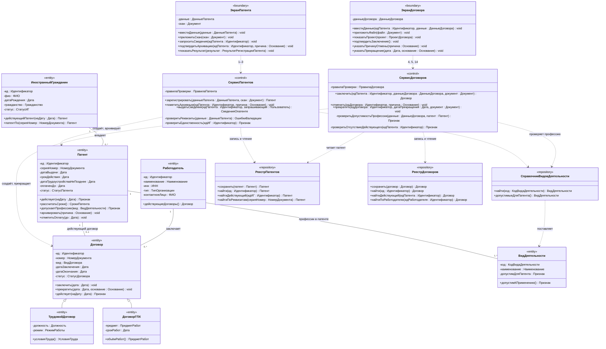

# Диаграмма 02. Патенты и договоры

**Дисциплина:** Функциональное моделирование систем · **ТюмГУ**, 5 семестр · **Преподаватель:** Ткаченко И. Н.
**Тема (раздел дорожной карты):** Тема 7. Действия после получения патента · **Команда:** Малышева Елена, Макеев Глеб, Мальгин Олег
**Автор работы:** Макеев Глеб, Мальгин Олег Борисович · **Дата:** 25.10.2026 · **Репозиторий:** <https://github.com/mflkee/fms-course>

> **Лабораторная 5, диаграмма классов проектирования.** Операции 1–5 и 14: учёт патента, архив,
> сведения о патенте, заключение / отмена / прекращение договора. Классы без привязки к языку
> реализации; типы — предметные.

## 1. Что показывает диаграмма

- **Два управляющих класса** — `СервисПатентов` и `СервисДоговоров` — и их методы, совпадающие с
  системными операциями лаб. 3 (`зарегистрировать`, `пометитьАрхивным`, `выдатьСведения`,
  `заключить`, `отменить`, `прекратить`).
- **Наследование `Договор` → `ТрудовойДоговор` / `ДоговорГПХ`**: общие реквизиты и статус в базовом
  классе, различие правовых форм — в подклассах.
- **Проверки инвариантов внутри сервиса, а не в экране:** `проверитьЕдинственность` (ИНВ-6),
  `проверитьДопустимостьПрофессии` (ИНВ-4), `проверитьОтсутствиеДействующего` (ИНВ-1).
- **Два хранилища** — `РеестрПатентов`, `РеестрДоговоров` — и справочник видов деятельности
  (ИНВ-4 проверяется по нему, а не по строке из формы).

## 2. Диаграмма

PlantUML-исходник: [`02-patent-dogovor.puml`](02-patent-dogovor.puml) · рендер: [`02-patent-dogovor.png`](02-patent-dogovor.png).

## 3. Комментарии к решениям

| Решение | Почему так |
|---|---|
| Методы операций — у сервисов, а не у сущностей | Системная операция — это сценарий, который затрагивает несколько сущностей; в сущности остаются только «свои» изменения (`архивировать`, `прекратить`, `отметитьОплату`) |
| Проверки ИНВ-1/3/4 внутри `СервисДоговоров` | Иначе правило действовало бы только при вызове из экрана; сервис — единственная точка входа для операции 4 |
| `Договор` абстрактный | У трудового договора и ГПХ разный набор реквизитов (должность/режим против предмета/срока работ), но одинаковые статус и жизненный цикл |
| Один `Патент` — один действующий договор | Кратность `1 → 0..1` на диаграмме и проверка `проверитьОтсутствиеДействующего` в сервисе: история договоров хранится, но действующий — только один (ИНВ-1) |
| `ВидДеятельности` — отдельная сущность, а не строка | Профессия в патенте — позиция справочника; ИНВ-4 проверяется сопоставлением кодов, а не сравнением текста |
| Даты и суммы — предметные типы | `Дата`, `Сумма`, `НомерДокумента`: без `String`/`int`/`UUID`, чтобы диаграмма не зависела от языка |

## 4. Согласование с лаб. 4

| Компонент лаб. 4 | Класс лаб. 5 | Что изменилось |
|---|---|---|
| `СервисПатентов` | класс `<<control>>` с методами операций 1–3 | добавлены сигнатуры и приватные проверки |
| `СервисДоговоров` | класс `<<control>>` с методами операций 4, 5, 14 | добавлены проверки ИНВ-1/3/4 |
| `РеестрПатентов` (был один на всё) | `РеестрПатентов` + `РеестрДоговоров` | в лаб. 4 хранилище было общим; в модели проектирования разделено по агрегатам, чтобы договоры не зависели от структуры патентов |
| `СправочникВидовДеятельности` | класс `<<repository>>` | без изменений |

Назад: [README лаб. 5](../README.md) · [диаграмма 01](01-layers.md) · [диаграмма 03](03-uvedomleniya-kontrol.md)
