# Диаграмма 03. Уведомления МВД, контроль сроков, напоминания

**Дисциплина:** Функциональное моделирование систем · **ТюмГУ**, 5 семестр · **Преподаватель:** Ткаченко И. Н.
**Тема (раздел дорожной карты):** Тема 7. Действия после получения патента · **Команда:** Малышева Елена, Макеев Глеб, Мальгин Олег
**Автор работы:** Макеев Глеб, Мальгин Олег Борисович · **Дата:** 25.10.2026 · **Репозиторий:** <https://github.com/mflkee/fms-course>

> **Лабораторная 5, диаграмма классов проектирования.** Операции 6–10: направление уведомления в МВД,
> фиксация возврата, настройка напоминаний, пересчёт сроков, фиксация нарушения срока.
> Без привязки к языку реализации; типы — предметные.

## 1. Что показывает диаграмма

- **Один шлюз на канал связи:** `ШлюзЕПГУ` и `ШлюзПочты` — разные классы, но `СервисУведомлений`
  работает с ними одинаково: канал — параметр операции 6, а не отдельный сценарий.
- **Правило сроков в одном месте:** `МодульКонтроляСроков` создаёт и закрывает контрольные точки,
  рассчитывает плановые даты. Его вызывают операции 1, 4, 6, 9, 10, 14 — дублирования правила
  «2 месяца с даты выдачи патента» в других классах нет.
- **Композиция «точка → напоминание»:** `Напоминание` создаётся только по открытой контрольной точке
  и снимается вместе с её закрытием (ИНВ-9).
- **Внутренний триггер:** `ПланировщикЗадач` — управляющий класс, который запускает операции 9 и 10
  по расписанию. Это не актор лаб. 1, а компонент подсистемы (решение лаб. 4 сохранено).

## 2. Диаграмма

```mermaid
classDiagram
    direction TB

    class ЭкранУведомленияМВД {
        <<boundary>>
        -выбранныйКанал : КаналУведомления
        +показатьПроект(проект : ПроектУведомления) void
        +выбратьКанал(канал : КаналУведомления) void
        +подтвердитьОтправку(подтверждение : ПодтверждениеОтправки) void
        +показатьДоказательства(уведомление : УведомлениеМВД) void
        +сообщитьОВозврате(причина : Основание, документВозврата : Документ) void
    }

    class ЭкранНапоминаний {
        <<boundary>>
        -настройки : НастройкиНапоминаний
        +выбратьКаналы(каналы : КаналУведомления) void
        +указатьМоменты(моменты : МоментНапоминания) void
        +подтвердитьСогласие(согласие : Признак) void
        +показатьРасписание(напоминания : Напоминание) void
    }

    class СервисУведомлений {
        <<control>>
        -правилаФормирования : ПравилаУведомления
        +направить(идДоговора : Идентификатор, канал : КаналУведомления) УведомлениеМВД
        +зафиксироватьВозврат(идУведомления : Идентификатор, документВозврата : Документ) void
        -сформироватьПроект(идДоговора : Идентификатор) ПроектУведомления
        -выбратьОрган(идДоговора : Идентификатор) ТерриториальныйОрганМВД
        -сохранитьДоказательства(уведомление : УведомлениеМВД) void
    }

    class МодульКонтроляСроков {
        <<control>>
        -срокТрудоустройства : СрокПравило
        +пересчитать(идПатента : Идентификатор, основание : Основание) СводкаСроков
        +зафиксироватьНарушение(идТочки : Идентификатор, датаОбнаружения : Дата) void
        +открытьТочку(идПатента : Идентификатор, вид : ВидТочки) КонтрольнаяТочка
        +закрытьТочку(идТочки : Идентификатор, основание : Основание) void
        -рассчитатьПлановуюДату(вид : ВидТочки, датаВыдачи : Дата) Дата
    }

    class СервисНапоминаний {
        <<control>>
        -моментыПоУмолчанию : МоментНапоминания
        +настроить(идПрофиля : Идентификатор, каналы : КаналУведомления, моменты : МоментНапоминания) void
        +запланировать(идТочки : Идентификатор, моменты : МоментНапоминания) Напоминание
        +доставить(напоминание : Напоминание) void
        +прекратить(идТочки : Идентификатор) void
        +эскалировать(точка : КонтрольнаяТочка) void
    }

    class ПланировщикЗадач {
        <<control>>
        -расписание : РасписаниеКонтроля
        +запуститьЕжедневныйКонтроль() void
        +отобратьПатентыСКонтролем() Патент
        +передатьВОбработку(идПатента : Идентификатор) void
    }

    class УведомлениеМВД {
        <<entity>>
        -ид : Идентификатор
        -датаНаправления : Дата
        -канал : КаналУведомления
        -номерКвитанции : НомерДокумента
        -трекНомер : ТрекНомер
        -статус : СтатусУведомления
        +направить(канал : КаналУведомления, подтверждение : ПодтверждениеОтправки) void
        +зафиксироватьДоставку(квитанция : Квитанция) void
        +зафиксироватьОшибку(причина : Основание) void
        +доказательства() Документ
    }

    class КонтрольнаяТочка {
        <<entity>>
        -ид : Идентификатор
        -вид : ВидТочки
        -плановаяДата : Дата
        -фактическаяДата : Дата
        -критическая : Признак
        -статус : СтатусТочки
        +просрочена(наДату : Дата) Признак
        +выполнить(дата : Дата) void
        +отметитьНарушение(дата : Дата) void
        +отменить(основание : Основание) void
    }

    class Напоминание {
        <<entity>>
        -ид : Идентификатор
        -датаОтправки : ДатаВремя
        -канал : КаналУведомления
        -текст : ТекстНапоминания
        -статус : СтатусНапоминания
        +отправить(канал : КаналУведомления) void
        +отметитьДоставку() void
        +отменить() void
    }

    class ТерриториальныйОрганМВД {
        <<entity>>
        -код : КодОргана
        -наименование : Наименование
        -адрес : Адрес
        +реквизитыАдресата() РеквизитыАдресата
    }

    class РеестрУведомлений {
        <<repository>>
        +сохранить(уведомление : УведомлениеМВД) УведомлениеМВД
        +найти(ид : Идентификатор) УведомлениеМВД
        +найтиПоДоговору(идДоговора : Идентификатор) УведомлениеМВД
        +история(идДоговора : Идентификатор) УведомлениеМВД
    }

    class ШлюзЕПГУ {
        <<gateway>>
        +отправить(уведомление : УведомлениеМВД, подпись : ПодписьЭП) Квитанция
        +проверитьСтатус(номерКвитанции : НомерДокумента) СтатусДоставки
    }

    class ШлюзПочты {
        <<gateway>>
        +отправить(уведомление : УведомлениеМВД, адресат : ТерриториальныйОрганМВД) ТрекНомер
        +сведенияОВозврате(трекНомер : ТрекНомер) Документ
    }

    ЭкранУведомленияМВД ..> СервисУведомлений : 6, 7
    ЭкранНапоминаний ..> СервисНапоминаний : 8
    ПланировщикЗадач ..> МодульКонтроляСроков : 9, 10 по расписанию
    ПланировщикЗадач ..> СервисНапоминаний : доставка
    СервисУведомлений ..> УведомлениеМВД : создаёт, меняет статус
    СервисУведомлений ..> РеестрУведомлений : запись и чтение
    СервисУведомлений ..> МодульКонтроляСроков : закрывает точку
    СервисУведомлений ..> ШлюзЕПГУ : канал ЕПГУ
    СервисУведомлений ..> ШлюзПочты : канал почта
    СервисУведомлений ..> ТерриториальныйОрганМВД : адресат
    СервисНапоминаний ..> Напоминание : создаёт
    СервисНапоминаний ..> МодульКонтроляСроков : читает сроки
    МодульКонтроляСроков ..> КонтрольнаяТочка : создаёт, закрывает
    КонтрольнаяТочка "1" -- "0..*" Напоминание : напоминания
    УведомлениеМВД "0..*" -- "1" ТерриториальныйОрганМВД : адресат
```

PlantUML-исходник: [`03-uvedomleniya-kontrol.puml`](03-uvedomleniya-kontrol.puml) · рендер: [`03-uvedomleniya-kontrol.png`](03-uvedomleniya-kontrol.png).

## 3. Комментарии к решениям

| Решение | Почему так |
|---|---|
| Канал — параметр, а не класс | Специальное требование П03: проект уведомления формируется один раз и одинаково для ЕПГУ и почты; различается только доставка |
| Шлюзы отделены от сервиса | Ошибка канала (СМЭВ, возврат письма) не должна менять модель уведомления: `СервисУведомлений` получает результат шлюза и переводит `УведомлениеМВД` в статус «ошибка» |
| `МодульКонтроляСроков` владеет точками | Все сроки — производные от даты выдачи патента; если бы точку создавал каждый сервис, правило пришлось бы дублировать (и оно бы расходилось) |
| Напоминание — отдельная сущность | У напоминания свой статус, канал и факт доставки; серия напоминаний по точке (30/14/7/3/1 день) — это `1 → 0..*` |
| `ПланировщикЗадач` — класс, не актор | Время в лаб. 1 актором не объявлено; планировщик — внутренний триггер, его вызовы видны на диаграмме (операции 9, 10) |
| `ТерриториальныйОрганМВД` — сущность | Адресат уведомления хранится и используется при отправке; это понятие предметной области, в отличие от самого МВД как внешней системы |

## 4. Согласование с лаб. 4

| Компонент лаб. 4 | Класс лаб. 5 | Что изменилось |
|---|---|---|
| `СервисУведомлений` | `<<control>>` + методы операций 6–7 | добавлены приватные `сформироватьПроект`, `выбратьОрган`, `сохранитьДоказательства` |
| `МодульКонтроляСроков` | `<<control>>` + методы 9–10 | добавлены `открытьТочку` / `закрытьТочку` / `рассчитатьПлановуюДату` |
| `СервисНапоминаний` | `<<control>>` + метод 8 | добавлены `запланировать`, `доставить`, `эскалировать` |
| `ПланировщикЗадач` | `<<control>>` | получил операции отбора патентов и передачи в обработку |
| `РеестрУведомлений` | `<<repository>>` | в лаб. 4 уведомления лежали в общем `РеестреПатентов`; выделены в отдельное хранилище (ИНВ-8: хранятся бессрочно) |

Назад: [README лаб. 5](../README.md) · [диаграмма 02](02-patent-dogovor.md) · [диаграмма 04](04-ndfl.md)
