# Диаграмма 03. Уведомление МВД и контроль сроков

**Дисциплина:** Функциональное моделирование систем · **ТюмГУ**, 5 семестр · **Преподаватель:** Ткаченко И. Н.
**Тема (раздел дорожной карты):** Тема 7. Действия после получения патента · **Команда:** Малышева Елена, Макеев Глеб
**Автор работы:** Макеев Глеб Борисович · **Дата:** 20.11.2026 · **Репозиторий:** <https://github.com/mflkee/fms-course>

> **Лабораторная 5, диаграмма классов проектирования.** Операции 6–10: направление уведомления в МВД,
> фиксация возврата, пересчёт сроков, настройка напоминаний, фиксация нарушения срока.
> Без привязки к языку реализации; типы — предметные.

## 1. Что показывает диаграмма

- **Два управляющих класса** — `СервисУведомлений` (операции 6–7) и `СервисСроков` (операции 8–10) —
  с методами, названными ровно как системные операции [DESIGN.md §3](../../DESIGN.md).
- **Канал — параметр, а не класс:** `СервисУведомлений` формирует уведомление один раз и передаёт его
  либо в `ШлюзЕПГУ`, либо в `ШлюзПочты`. У шлюза один метод — `отправить`.
- **Правило сроков в одном месте:** `СервисСроков` создаёт и закрывает контрольные точки, считает
  плановые даты и планирует напоминания. Дублирования правила «2 месяца с даты выдачи патента» нет.
- **Композиция «патент → точка → напоминание»:** напоминание создаётся только по открытой точке и
  снимается вместе с её закрытием; отдельного репозитория у напоминаний нет.
- **Сущности без методов:** у `УведомлениеМВД`, `КонтрольнаяТочка`, `Напоминание`,
  `ТерриториальныйОрганМВД`, `Документ` — только атрибуты из [DESIGN.md §5](../../DESIGN.md).

## 2. Диаграмма

```mermaid
classDiagram
    direction TB

    class ЭкранУведомления {
        <<boundary>>
        +направитьУведомлениеМВД(договор : Договор, канал : КаналУведомления) УведомлениеМВД
        +зафиксироватьВозвратУведомления(уведомление : УведомлениеМВД, документВозврата : Документ) void
    }

    class ЭкранСроков {
        <<boundary>>
        +пересчитатьСрокиПатента(патент : Патент) СводкаСроков
        +настроитьНапоминания(патент : Патент, каналы : КаналУведомления, моменты : МоментНапоминания) void
        +зафиксироватьНарушениеСрока(точка : КонтрольнаяТочка, датаОбнаружения : Дата) void
    }

    class СервисУведомлений {
        <<control>>
        +направитьУведомлениеМВД(договор : Договор, канал : КаналУведомления) УведомлениеМВД
        +зафиксироватьВозвратУведомления(уведомление : УведомлениеМВД, документВозврата : Документ) void
    }

    class СервисСроков {
        <<control>>
        +пересчитатьСрокиПатента(патент : Патент) СводкаСроков
        +настроитьНапоминания(патент : Патент, каналы : КаналУведомления, моменты : МоментНапоминания) void
        +зафиксироватьНарушениеСрока(точка : КонтрольнаяТочка, датаОбнаружения : Дата) void
    }

    class УведомлениеМВД {
        <<entity>>
        датаНаправления : Дата
        канал : КаналУведомления
        номерКвитанции : НомерДокумента
        трекНомер : ТрекНомер
        копияДоговора : Документ
        статус : СтатусУведомления
    }

    class КонтрольнаяТочка {
        <<entity>>
        вид : ВидТочки
        плановаяДата : Дата
        фактическаяДата : Дата
        критическая : Признак
        статус : СтатусТочки
    }

    class Напоминание {
        <<entity>>
        датаОтправки : Дата
        канал : КаналУведомления
        текст : ТекстНапоминания
        статус : СтатусНапоминания
    }

    class Документ {
        <<entity>>
        тип : ТипДокумента
        имяФайла : ИмяФайла
        хэш : ХэшСодержимого
        датаЗагрузки : Дата
        источник : ИсточникДокумента
    }

    class ТерриториальныйОрганМВД {
        <<entity>>
        код : КодОргана
        наименование : Наименование
        адрес : Адрес
    }

    class Патент {
        <<entity>>
        серия : НомерДокумента
        номер : НомерДокумента
        датаВыдачи : Дата
        срокДействия : Дата
        органВыдавший : Наименование
        статус : СтатусПатента
    }

    class Договор {
        <<entity>>
        <<abstract>>
        номер : НомерДокумента
        вид : ВидДоговора
        датаЗаключения : Дата
        датаОкончания : Дата
        статус : СтатусДоговора
    }

    class РепозиторийУведомлений {
        <<repository>>
        +сохранить(уведомление : УведомлениеМВД) УведомлениеМВД
        +найтиПоДоговору(договор : Договор) УведомлениеМВД
    }

    class РепозиторийПатентов {
        <<repository>>
        +сохранить(патент : Патент) Патент
        +найти(серия : НомерДокумента, номер : НомерДокумента) Патент
    }

    class РепозиторийДоговоров {
        <<repository>>
        +сохранить(договор : Договор) Договор
        +найтиДействующий(патент : Патент) Договор
    }

    class ШлюзЕПГУ {
        <<gateway>>
        +отправить(уведомление : УведомлениеМВД) Квитанция
    }

    class ШлюзПочты {
        <<gateway>>
        +отправить(уведомление : УведомлениеМВД, адресат : ТерриториальныйОрганМВД) ТрекНомер
    }

    ЭкранУведомления ..> СервисУведомлений : операции 6–7
    ЭкранСроков ..> СервисСроков : операции 8–10

    СервисУведомлений ..> УведомлениеМВД : создаёт, меняет статус
    СервисУведомлений ..> ТерриториальныйОрганМВД : адресат
    СервисУведомлений ..> Документ : копия договора и доказательства
    СервисУведомлений ..> РепозиторийУведомлений : сохраняет и находит
    СервисУведомлений ..> РепозиторийДоговоров : читает договор
    СервисУведомлений ..> ШлюзЕПГУ : канал ЕПГУ
    СервисУведомлений ..> ШлюзПочты : канал почта

    СервисСроков ..> Патент : читает сроки
    СервисСроков ..> КонтрольнаяТочка : создаёт, закрывает
    СервисСроков ..> Напоминание : создаёт
    СервисСроков ..> РепозиторийПатентов : сохраняет и находит

    Патент "1" *-- "0..*" КонтрольнаяТочка : контрольные точки
    КонтрольнаяТочка "1" -- "0..*" Напоминание : напоминания
    Договор "1" -- "0..1" УведомлениеМВД : уведомление по договору
    УведомлениеМВД "0..*" -- "1" ТерриториальныйОрганМВД : адресат
    УведомлениеМВД "1" o-- "0..*" Документ : вложения
    Патент "1" o-- "0..*" Документ : вложения
```

PlantUML-исходник: [`03-uvedomleniya-sroki.puml`](03-uvedomleniya-sroki.puml) · рендер: [`03-uvedomleniya-sroki.png`](03-uvedomleniya-sroki.png).

## 3. Комментарии к решениям

| Решение | Почему так |
|---|---|
| Канал — параметр, а не класс | Проект уведомления формируется один раз и одинаково для ЕПГУ и почты; различается только доставка |
| У шлюза только `отправить` | Границы подсистемы жёсткие: она не отслеживает статусы доставки. Квитанция и трек-номер — результат отправки, а не отдельная операция |
| Шлюзы отделены от сервиса | Ошибка канала не должна менять модель уведомления: сервис получает результат и переводит `УведомлениеМВД` в статус «ошибка» |
| `СервисСроков` владеет точками | Все сроки производны от даты выдачи патента; если бы точку создавал каждый сервис, правило дублировалось бы |
| Напоминание — сущность без своего репозитория | Оно не существует без контрольной точки и сохраняется вместе с агрегатом патента |
| `ТерриториальныйОрганМВД` — сущность | Адресат хранится и используется при отправке; это понятие предмета, а не внешняя система |
| Нет планировщика и нет расписания | Сроки считаются по запросу (`пересчитатьСрокиПатента`); фоновых задач в модели нет |

## 4. Согласование с лаб. 4

| Компонент лаб. 4 | Класс лаб. 5 | Что изменилось |
|---|---|---|
| `СервисУведомлений` | `<<control>>`, методы операций 6–7 | имена методов совпадают с именами операций |
| `МодульКонтроляСроков` + `СервисНапоминаний` | `СервисСроков` | два класса слиты: сроки и напоминания — один сценарий П04, три операции |
| `ПланировщикЗадач` | — (удалён) | фонового расписания в теме 7 нет: операции 8–10 вызываются из экрана |
| хранилище уведомлений лаб. 4 | `РепозиторийУведомлений` | только сохранение и поиск по договору |
| `ШлюзЕПГУ`, `ШлюзПочты` | без изменений | убраны методы проверки статуса и сведений о возврате: возврат фиксируется операцией 7 |

Назад: [README лаб. 5](../README.md) · [диаграмма 02](02-patent-dogovor.md)
