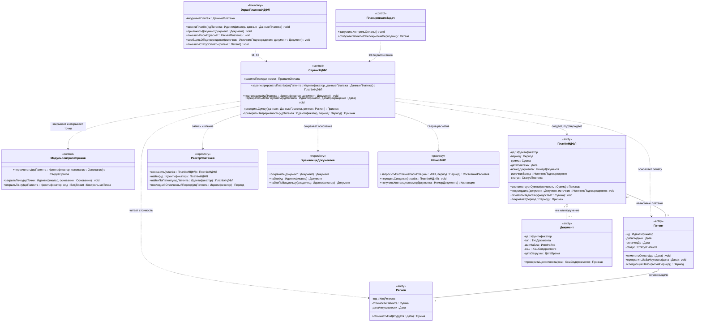

# Диаграмма 04. Учёт НДФЛ

**Дисциплина:** Функциональное моделирование систем · **ТюмГУ**, 5 семестр · **Преподаватель:** Ткаченко И. Н.
**Тема (раздел дорожной карты):** Тема 7. Действия после получения патента · **Команда:** Малышева Елена, Макеев Глеб
**Автор работы:** Макеев Глеб Борисович · **Дата:** 25.10.2026 · **Репозиторий:** <https://github.com/mflkee/fms-course>

> **Лабораторная 5, диаграмма классов проектирования.** Операции 11–13: регистрация авансового
> платежа НДФЛ, подтверждение платежа по документу, прекращение патента из-за неуплаты.
> Без привязки к языку реализации; типы — предметные.

## 1. Что показывает диаграмма

- **Сверка с внешней системой через шлюз:** `ШлюзФНС.запроситьСостояниеРасчётов` и `получитьКвитанцию`;
  сам порядок обмена (ГИС ГМП, СМЭВ) в модели не раскрывается.
- **Проверка суммы по региону (ИНВ-7):** `СервисНДФЛ.проверитьСумму` получает `Регион` и сравнивает
  стоимость патента на дату платежа — стоимость не хранится в платеже, она вычисляется.
- **Ручной ввод виден в модели:** атрибут `источникВвода` у `ПлатёжНДФЛ`; подтверждение по документу
  не должно выглядеть как автоматическое поступление из ФНС (требование П05).
- **Прекращение патента — метод сервиса, а не отдельная сущность «Инцидент»:** `прекратитьИзЗаНеуплаты`
  меняет статус `Патента` и закрывает точки через `МодульКонтроляСроков`.

## 2. Диаграмма

PlantUML-исходник: [`04-ndfl.puml`](04-ndfl.puml) · рендер: [`04-ndfl.png`](04-ndfl.png).

## 3. Комментарии к решениям

| Решение | Почему так |
|---|---|
| Стоимость патента не копируется в платёж | Стоимость устанавливается законом субъекта РФ и меняется; в платеже хранится сумма, а соответствие проверяется по `Регион.стоимостьНаДату` (ИНВ-7) |
| `источникВвода` — обязательный атрибут | Требование П05: ручное подтверждение должно быть отличимо от автоматического поступления |
| У платежа есть документ-основание | Операции 11–12 принимают документ (чек, платёжное поручение); без него подтверждение недоказуемо |
| Прекращение патента — метод `СервисНДФЛ` | Инициатор — контроль оплаты, а не отдельная предметная сущность; в лаб. 2 сущности «Инцидент» нет и она не вводится |
| `РеестрПлатежей` отдельно от `РеестраПатентов` | Платежи — самостоятельный агрегат с массовыми выборками по периодам; патент не должен знать о платежах больше, чем `оплаченДо` |
| `ХранилищеДокументов` — общее хранилище | Документы нужны и НДФЛ, и уведомлениям, и договорам; один класс с методами `сохранить` / `найти` / `найтиПоВладельцу` |

## 4. Согласование с лаб. 4

| Компонент лаб. 4 | Класс лаб. 5 | Что изменилось |
|---|---|---|
| `СервисНДФЛ` | `<<control>>` + методы 11–13 | добавлены `проверитьСумму`, `проверитьНепрерывность` |
| `РеестрПатентов` | `РеестрПлатежей` | платежи выделены в собственное хранилище |
| `ШлюзФНС` | `<<gateway>>` | без изменений; добавлен `получитьКвитанцию` |
| `ПланировщикЗадач` | `<<control>>` | добавлен запуск контроля оплаты (операция 13) |
| `Документ` (в лаб. 4 — объект) | класс `<<entity>>` + `ХранилищеДокументов` | документы получили собственное хранилище и проверку целостности по хэшу |

Назад: [README лаб. 5](../README.md) · [диаграмма 03](03-uvedomleniya-kontrol.md) · [диаграмма 05](05-otchety-dostup.md)
