# Диаграмма 05. Отчёты, права доступа, аудит

**Дисциплина:** Функциональное моделирование систем · **ТюмГУ**, 5 семестр · **Преподаватель:** Ткаченко И. Н.
**Тема (раздел дорожной карты):** Тема 7. Действия после получения патента · **Команда:** Малышева Елена, Макеев Глеб, Мальгин Олег
**Автор работы:** Макеев Глеб, Мальгин Олег Борисович · **Дата:** 25.10.2026 · **Репозиторий:** <https://github.com/mflkee/fms-course>

> **Лабораторная 5, диаграмма классов проектирования.** Операции 15–16: формирование сводного реестра
> и выгрузка файла с проверкой прав. Здесь же — иерархия `Пользователь` (роли лаб. 2).
> Без привязки к языку реализации; типы — предметные.

## 1. Что показывает диаграмму

- **Разделение обязанностей трёх управляющих классов:** `МодульОтчётности` строит срез,
  `МодульПравДоступа` отвечает на вопрос «можно ли», `ЖурналАудита` фиксирует факт. Ни один не решает
  чужую задачу — это делает операции 15–16 проверяемыми.
- **Два разных права:** право на отчёт и право на персональные данные. Без второго выгрузка
  обезличивается (`МодульОтчётности.обезличить`), а не отклоняется.
- **`ОтчётРеестр` — класс, а не временная структура:** срез фиксируется на момент запуска и хранится,
  на него ссылается операция 16 (`идРеестра`), поэтому у него есть собственный жизненный цикл.
- **Иерархия `Пользователь`** с тремя ролями лаб. 2: `ПользовательИГ`,
  `ПредставительРаботодателя`, `АдминистраторСистемы`; право выгрузки — атрибут администратора,
  а проверка прав вынесена в отдельный класс.

## 2. Диаграмма

```mermaid
classDiagram
    direction TB

    class ЭкранРеестра {
        <<boundary>>
        -параметры : ПараметрыОтчёта
        +задатьПараметры(параметры : ПараметрыОтчёта) void
        +показатьРеестр(реестр : ОтчётРеестр) void
        +выбратьФормат(формат : ФорматВыгрузки) void
        +запроситьВыгрузку(идРеестра : Идентификатор) void
    }

    class ЭкранАдминистрирования {
        <<boundary>>
        +показатьЖурнал(события : СобытиеАудита) void
        +настроитьПрава(пользователь : Пользователь, права : НаборПрав) void
        +заблокироватьУчётнуюЗапись(пользователь : Пользователь) void
    }

    class МодульОтчётности {
        <<control>>
        -правилаАгрегации : ПравилаОтчёта
        +сформировать(параметры : ПараметрыОтчёта, пользователь : Пользователь) ОтчётРеестр
        +выгрузить(идРеестра : Идентификатор, формат : ФорматВыгрузки, пользователь : Пользователь) ФайлВыгрузки
        -построитьСрез(параметры : ПараметрыОтчёта) ОтчётРеестр
        -обезличить(реестр : ОтчётРеестр) ОтчётРеестр
    }

    class МодульПравДоступа {
        <<control>>
        -матрицаПрав : МатрицаПрав
        +проверитьПраво(пользователь : Пользователь, право : Право) Признак
        +правоНаПерсональныеДанные(пользователь : Пользователь) Признак
        +требуетсяОбезличивание(пользователь : Пользователь) Признак
    }

    class ЖурналАудита {
        <<control>>
        -записи : СобытиеАудита
        +записать(событие : СобытиеАудита) void
        +выбрать(фильтр : ФильтрАудита) СобытиеАудита
        +зафиксироватьОтказ(событие : СобытиеАудита) void
    }

    class ОтчётРеестр {
        <<entity>>
        -ид : Идентификатор
        -параметры : ПараметрыОтчёта
        -срез : ДатаВремя
        -строки : СтрокаРеестра
        -критическихЗаписей : Количество
        +добавитьСтроку(строка : СтрокаРеестра) void
        +критические() СтрокаРеестра
        +устарел(наДату : Дата) Признак
        +обезличить() ОтчётРеестр
    }

    class Пользователь {
        <<entity>>
        -ид : Идентификатор
        -логин : Логин
        -контакт : Контакт
        -активен : Признак
        +роли() Роль
        +учтёнВ(журнал : ЖурналАудита) СобытиеАудита
    }

    class ПользовательИГ {
        <<entity>>
        -предпочитаемыйКанал : КаналУведомления
        +настройкиНапоминаний() НастройкиНапоминаний
        +свойПатент() Патент
    }

    class ПредставительРаботодателя {
        <<entity>>
        -должность : Должность
        +свойРаботодатель() Работодатель
    }

    class АдминистраторСистемы {
        <<entity>>
        -правоВыгрузки : Признак
        +можетВыгружать() Признак
        +права() НаборПрав
    }

    class РеестрПатентов {
        <<repository>>
        +найтиПоПараметрам(параметры : ПараметрыОтчёта) Патент
        +найти(ид : Идентификатор) Патент
    }

    class РеестрДоговоров {
        <<repository>>
        +найтиПоПараметрам(параметры : ПараметрыОтчёта) Договор
        +найтиПоПатенту(идПатента : Идентификатор) Договор
    }

    ЭкранРеестра ..> МодульОтчётности : 15, 16
    ЭкранАдминистрирования ..> ЖурналАудита : просмотр журнала
    ЭкранАдминистрирования ..> МодульПравДоступа : настройка прав
    МодульОтчётности ..> МодульПравДоступа : проверка права
    МодульОтчётности ..> ЖурналАудита : запись события
    МодульОтчётности ..> ОтчётРеестр : создаёт срез
    МодульОтчётности ..> РеестрПатентов : выборка патентов
    МодульОтчётности ..> РеестрДоговоров : выборка договоров
    Пользователь <|-- ПользовательИГ
    Пользователь <|-- ПредставительРаботодателя
    Пользователь <|-- АдминистраторСистемы
    Пользователь "1" -- "0..*" ОтчётРеестр : формирует
```

PlantUML-исходник: [`05-otchety-dostup.puml`](05-otchety-dostup.puml) · рендер: [`05-otchety-dostup.png`](05-otchety-dostup.png).

## 3. Комментарии к решениям

| Решение | Почему так |
|---|---|
| `МодульПравДоступа` отдельно от `МодульОтчётности` | Права проверяются и в других операциях (3 — сведения о патенте, 11 — оплата); один класс-правило вместо копий в каждом сервисе |
| Обезличивание вместо отказа | Требование П07: администратор без права на персональные данные получает обезличенный файл, а попытка полной выгрузки фиксируется как отказ в журнале |
| `ЖурналАудита` — управляющий класс, а не хранилище | Его задача — записать и выдать события по фильтру, а не хранить произвольные сущности; поэтому в модели он `<<control>>`, хотя события накапливает |
| `ОтчётРеестр` — отдельный класс | Срез фиксируется на момент запуска, хранится и может устареть (`устарел`); это поведение, а не структура результата |
| `Пользователь` остался абстрактным | Три роли из лаб. 2 различаются правами и связями (ИГ ↔ патент, представитель ↔ работодатель), а не набором учётных данных |
| Права — предметный тип `НаборПрав` | Модель не описывает битовые маски и таблицы ролей: это уровень реализации (лаб. 6) |

## 4. Согласование с лаб. 4

| Компонент лаб. 4 | Класс лаб. 5 | Что изменилось |
|---|---|---|
| `МодульОтчётности` | `<<control>>` + методы 15–16 | добавлены `построитьСрез`, `обезличить` |
| `МодульПравДоступа` | `<<control>>` | добавлены `правоНаПерсональныеДанные`, `требуетсяОбезличивание` |
| `ЖурналАудита` | `<<control>>` | добавлены `записать`, `выбрать`, `зафиксироватьОтказ` |
| `АдминистраторСистемы` (сущность лаб. 2) | класс `<<entity>>` в иерархии `Пользователь` | сохранён атрибут `правоВыгрузки`, добавлены методы |
| `РеестрПатентов`, `РеестрДоговоров` | `<<repository>>` с выборкой по параметрам отчёта | выборка «по параметрам» нужна только отчётности, поэтому методы чтения добавлены здесь |

Назад: [README лаб. 5](../README.md) · [диаграмма 04](04-ndfl.md)
